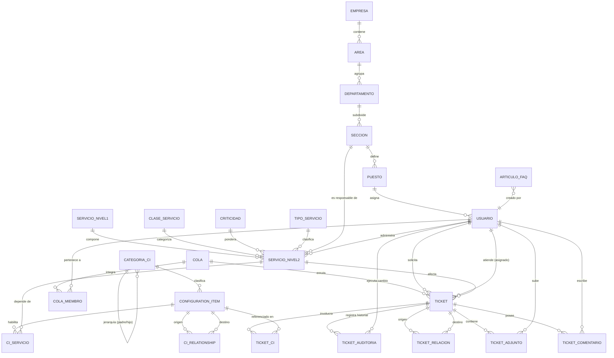

# Modelo de Datos y Diccionario de Base de Datos (`docs/MODELO.md`)

**Asignatura:** Software Avanzado | USAC  
**Estudiante:** Andrés Calvo | **Carné:** 201712620  
**Catedrático:** Msc. Marco Tulio Aldana Prillwitz | **GitHub:** `maldanap-usac`  
**Proyecto:** Sistema Integral de Catálogo de Servicios TI, CMDB y Service Desk (ITIL)  
**Base de Datos:** PostgreSQL 15 Relacional con Integridad Referencial y ACID  

---

## 1. Diagrama Entidad-Relación Integral (Mermaid)

El siguiente diagrama modela la totalidad del ecosistema: la estructura organizacional jerárquica, el catálogo de servicios TI en dos niveles, la Configuration Management Database (CMDB) de más de 5,000 elementos de configuración (CIs) con relaciones topológicas sin ciclos, y el subsistema de Service Desk para la gestión de colas y los 7 procesos ITIL.



---

## 2. Diccionario de Datos Detallado

### 2.1. Módulo Organizacional

#### Tabla: `empresas`
Entidad raíz del organigrama institucional.
| Columna | Tipo | Nulo | Restricciones / Default | Descripción |
|---|---|---|---|---|
| `id` | INTEGER | NO | PRIMARY KEY, AUTO_INCREMENT | Identificador numérico único de la empresa. |
| `codigo` | VARCHAR(50) | NO | UNIQUE, INDEX | Código institucional unívoco (ej. `EMP-01`). |
| `nombre` | VARCHAR(255) | NO | — | Razón social o denominación formal de la empresa. |
| `activo` | BOOLEAN | NO | DEFAULT TRUE | Indicador de estado para baja lógica. |
| `fecha_creacion` | TIMESTAMP | NO | DEFAULT CURRENT_TIMESTAMP | Fecha y hora de creación del registro. |

#### Tabla: `areas`
Divisiones funcionales de primer orden subordinadas a la empresa.
| Columna | Tipo | Nulo | Restricciones / Default | Descripción |
|---|---|---|---|---|
| `id` | INTEGER | NO | PRIMARY KEY, AUTO_INCREMENT | Identificador numérico único. |
| `codigo` | VARCHAR(50) | NO | INDEX | Código funcional (ej. `TI`). Único dentro de la empresa. |
| `nombre` | VARCHAR(255) | NO | — | Nombre formal del área funcional. |
| `empresa_id` | INTEGER | NO | FK `empresas(id)` ON DELETE RESTRICT | Empresa a la cual pertenece el área. |
| `activo` | BOOLEAN | NO | DEFAULT TRUE | Indicador de baja lógica. |

#### Tabla: `departamentos`
Unidades tácticas dependientes de un Área.
| Columna | Tipo | Nulo | Restricciones / Default | Descripción |
|---|---|---|---|---|
| `id` | INTEGER | NO | PRIMARY KEY, AUTO_INCREMENT | Identificador numérico único. |
| `codigo` | VARCHAR(50) | NO | INDEX | Código táctico (ej. `DEP-OPS`). Único dentro del área. |
| `nombre` | VARCHAR(255) | NO | — | Nombre del departamento. |
| `area_id` | INTEGER | NO | FK `areas(id)` ON DELETE RESTRICT | Área funcional a la que pertenece. |
| `activo` | BOOLEAN | NO | DEFAULT TRUE | Indicador de baja lógica. |

#### Tabla: `secciones`
Células de trabajo operativo subordinadas a un Departamento.
| Columna | Tipo | Nulo | Restricciones / Default | Descripción |
|---|---|---|---|---|
| `id` | INTEGER | NO | PRIMARY KEY, AUTO_INCREMENT | Identificador numérico único. |
| `codigo` | VARCHAR(50) | NO | INDEX | Código operativo (ej. `SEC-SOP`). Único en el departamento. |
| `nombre` | VARCHAR(255) | NO | — | Nombre de la sección operativa. |
| `departamento_id`| INTEGER | NO | FK `departamentos(id)` ON DELETE RESTRICT | Departamento al cual reporta. |
| `activo` | BOOLEAN | NO | DEFAULT TRUE | Indicador de baja lógica. |

#### Tabla: `puestos`
Cargos laborales definidos dentro de una Sección.
| Columna | Tipo | Nulo | Restricciones / Default | Descripción |
|---|---|---|---|---|
| `id` | INTEGER | NO | PRIMARY KEY, AUTO_INCREMENT | Identificador numérico único. |
| `codigo` | VARCHAR(50) | NO | INDEX | Código de plaza (ej. `PST-01`). Único en la sección. |
| `nombre` | VARCHAR(255) | NO | — | Denominación del puesto de trabajo. |
| `seccion_id` | INTEGER | NO | FK `secciones(id)` ON DELETE RESTRICT | Sección a la que está adscrito el puesto. |
| `activo` | BOOLEAN | NO | DEFAULT TRUE | Indicador de baja lógica. |

#### Tabla: `usuarios`
Cuentas de usuario que autentican y operan en la plataforma.
| Columna | Tipo | Nulo | Restricciones / Default | Descripción |
|---|---|---|---|---|
| `id` | INTEGER | NO | PRIMARY KEY, AUTO_INCREMENT | Identificador numérico único. |
| `nombre` | VARCHAR(255) | NO | — | Nombre completo del usuario. |
| `correo` | VARCHAR(255) | NO | UNIQUE, INDEX | Correo electrónico unívoco utilizado como login. |
| `password_hash` | VARCHAR(255) | NO | — | Hash de contraseña con salt generado mediante bcrypt. |
| `rol` | VARCHAR(50) | NO | DEFAULT 'consulta' | Rol de seguridad: `administrador` o `consulta`. |
| `activo` | BOOLEAN | NO | DEFAULT TRUE | Permiso de inicio de sesión (baja lógica). |
| `puesto_id` | INTEGER | SÍ | FK `puestos(id)` ON DELETE SET NULL | Puesto laboral ocupado en el organigrama. |

---

### 2.2. Módulo de Catálogo de Servicios TI

#### Tabla: `servicios_nivel1`
Categorías superiores de servicios de TI extraídas del Excel.
| Columna | Tipo | Nulo | Restricciones / Default | Descripción |
|---|---|---|---|---|
| `id` | INTEGER | NO | PRIMARY KEY, AUTO_INCREMENT | Identificador numérico único. |
| `codigo` | VARCHAR(50) | NO | UNIQUE, INDEX | Código padre unívoco (ej. `SE.01` hasta `SE.12`). |
| `nombre` | VARCHAR(255) | NO | — | Nombre canónico consolidado de la agrupación N1. |
| `activo` | BOOLEAN | NO | DEFAULT TRUE | Indicador de vigencia. |

#### Tabla: `servicios_nivel2`
Servicios técnicos operativos específicos (46 servicios físicos oficiales).
| Columna | Tipo | Nulo | Restricciones / Default | Descripción |
|---|---|---|---|---|
| `id` | INTEGER | NO | PRIMARY KEY, AUTO_INCREMENT | Identificador único del servicio. |
| `codigo` | VARCHAR(50) | NO | UNIQUE, INDEX | Código N2 unívoco (ej. `SE.01.1`, `SE.12.1`). |
| `nombre` | VARCHAR(255) | NO | — | Nombre descriptivo del servicio. |
| `activo` | VARCHAR(5) | SÍ | DEFAULT 'S' | Indicador original `S`/`N` o `NULL` si no constaba. |
| `descripcion` | TEXT | SÍ | — | Descripción funcional del servicio (opcional). |
| `metrica` | VARCHAR(255) | SÍ | — | Métrica para evaluar el nivel de servicio. |
| `minimo` | FLOAT | SÍ | CHECK (`minimo` <= `maximo`) | Umbral inferior de rendimiento acordado. |
| `maximo` | FLOAT | SÍ | — | Umbral superior de tolerancia acordado. |
| `nivel1_id` | INTEGER | NO | FK `servicios_nivel1(id)` ON DELETE RESTRICT | Servicio padre al que pertenece. |
| `clase_id` | INTEGER | SÍ | FK `clases_servicio(id)` ON DELETE SET NULL | Catálogo: `A DEMANDA` o `RECURRENTE`. |
| `criticidad_id`| INTEGER | SÍ | FK `criticidades(id)` ON DELETE SET NULL | Criticidad: `Very Low` a `Very High`. |
| `tipo_id` | INTEGER | SÍ | FK `tipos_servicio(id)` ON DELETE SET NULL | Tipo: `Back End`, `Front End`, `IT Ops`, etc. |
| `seccion_responsable_id` | INTEGER | SÍ | FK `secciones(id)` ON DELETE SET NULL | Sección dueña del servicio. |
| `usuario_responsable_id` | INTEGER | SÍ | FK `usuarios(id)` ON DELETE SET NULL | Funcionario a cargo (debe pertenecer a la sección). |

---

### 2.3. Módulo de CMDB (Configuration Management Database)

#### Tabla: `cmdb_categorias`
Árbol jerárquico de categorías de 3 niveles según la Lección 22.
| Columna | Tipo | Nulo | Restricciones / Default | Descripción |
|---|---|---|---|---|
| `id` | INTEGER | NO | PRIMARY KEY, AUTO_INCREMENT | Identificador de la categoría. |
| `codigo` | VARCHAR(50) | NO | UNIQUE, INDEX | Código jerárquico (ej. `HW-SRV-RACK`). |
| `nombre` | VARCHAR(255) | NO | — | Nombre formal de la categoría (ej. `Servidores Rack`). |
| `nivel` | INTEGER | NO | CHECK (`nivel` IN (1, 2, 3)) | Profundidad jerárquica (1=Familia, 2=Clase, 3=Tipo). |
| `padre_id` | INTEGER | SÍ | FK `cmdb_categorias(id)` ON DELETE RESTRICT | Categoría contenedora inmediata (sin ciclos). |
| `descripcion`| TEXT | SÍ | — | Alcance taxonómico de los dispositivos agrupados. |

#### Tabla: `cmdb_ci`
Inventario técnico de los más de 5,000 Elementos de Configuración (CIs).
| Columna | Tipo | Nulo | Restricciones / Default | Descripción |
|---|---|---|---|---|
| `id` | INTEGER | NO | PRIMARY KEY, AUTO_INCREMENT | Identificador numérico del CI. |
| `codigo` | VARCHAR(100) | NO | UNIQUE, INDEX | Tag o código de activo único (ej. `CI-HW-00042`). |
| `nombre` | VARCHAR(255) | NO | INDEX | Nombre del host, equipo o componente. |
| `categoria_id`| INTEGER | NO | FK `cmdb_categorias(id)` ON DELETE RESTRICT | Categoría de Nivel 3 a la que corresponde. |
| `tipo_ci` | VARCHAR(100) | NO | — | Tipo tecnológico (Servidor, Switch, Base de Datos, etc.). |
| `descripcion`| TEXT | SÍ | — | Especificaciones y propósito operativo. |
| `numero_serie`| VARCHAR(100) | SÍ | INDEX | Número de serie asignado por el fabricante. |
| `version` | VARCHAR(100) | SÍ | — | Versión de firmware, software o compilación. |
| `fecha_adquisicion`| DATE | SÍ | — | Fecha contable de adquisición o alta. |
| `estado` | VARCHAR(50) | NO | DEFAULT 'Operativo' | `Operativo`, `En Mantenimiento`, `En Reparación`, etc. |
| `ubicacion_fisica`| VARCHAR(255)| SÍ| — | Rack, Datacenter o sede física del activo. |
| `ip_address` | VARCHAR(50) | SÍ | INDEX | Dirección IPv4 asignada (solo equipos con red). |
| `mac_address`| VARCHAR(50) | SÍ | — | Dirección física MAC de interfaz de red. |
| `fabricante` | VARCHAR(100) | SÍ | — | Marca o fabricante (ej. Dell, Cisco, VMware). |
| `modelo` | VARCHAR(100) | SÍ | — | Modelo comercial del dispositivo. |
| `propietario`| VARCHAR(255) | SÍ | — | Área o custodio responsable del activo. |

#### Tabla: `cmdb_ci_relationships`
Grafo de topología y dependencias técnicas entre CIs (DAG).
| Columna | Tipo | Nulo | Restricciones / Default | Descripción |
|---|---|---|---|---|
| `id` | INTEGER | NO | PRIMARY KEY, AUTO_INCREMENT | Identificador de la relación. |
| `origen_id` | INTEGER | NO | FK `cmdb_ci(id)` ON DELETE CASCADE | CI que requiere o alberga (`from`). |
| `destino_id` | INTEGER | NO | FK `cmdb_ci(id)` ON DELETE CASCADE | CI proveedor o componente (`to`). |
| `tipo_relacion`| VARCHAR(50) | NO | INDEX | `depende_de`, `alojado_en`, `conectado_a`. |
| `descripcion`| VARCHAR(255) | SÍ | — | Detalle del enlace o puerto de conexión. |

#### Tabla: `cmdb_ci_servicios`
Matriz de trazabilidad entre CIs de infraestructura y Servicios TI de Negocio Nivel 2.
| Columna | Tipo | Nulo | Restricciones / Default | Descripción |
|---|---|---|---|---|
| `id` | INTEGER | NO | PRIMARY KEY, AUTO_INCREMENT | Identificador del vínculo. |
| `ci_id` | INTEGER | NO | FK `cmdb_ci(id)` ON DELETE CASCADE | Elemento de configuración de soporte. |
| `servicio_n2_id`| INTEGER | NO | FK `servicios_nivel2(id)` ON DELETE CASCADE | Servicio de Nivel 2 sustentado. |
| `rol` | VARCHAR(100) | SÍ | DEFAULT 'Componente Primario' | Rol en la entrega del servicio (Primario, Backup, etc.). |

---

### 2.4. Módulo de Service Desk, Colas y Tickets (ITIL)

#### Tabla: `sd_colas`
Colas de atención técnica estructuradas por especialidad y escalamiento.
| Columna | Tipo | Nulo | Restricciones / Default | Descripción |
|---|---|---|---|---|
| `id` | INTEGER | NO | PRIMARY KEY, AUTO_INCREMENT | Identificador numérico de la cola. |
| `codigo` | VARCHAR(50) | NO | UNIQUE, INDEX | Código corto (ej. `COLA-N1`, `COLA-SEG`). |
| `nombre` | VARCHAR(150) | NO | — | Nombre formal de la cola técnica. |
| `descripcion`| TEXT | SÍ | — | Especialidad y alcance técnico de la cola. |
| `nivel_escalamiento`| INTEGER | NO | DEFAULT 1 | Nivel de atención ITIL (Nivel 0 al 4). |
| `activo` | BOOLEAN | NO | DEFAULT TRUE | Indicador de disponibilidad operativa. |

#### Tabla: `sd_colas_miembros`
Membresía y permisos de agentes para despachar tickets en colas.
| Columna | Tipo | Nulo | Restricciones / Default | Descripción |
|---|---|---|---|---|
| `id` | INTEGER | NO | PRIMARY KEY, AUTO_INCREMENT | Identificador de la asignación. |
| `cola_id` | INTEGER | NO | FK `sd_colas(id)` ON DELETE CASCADE | Cola a la que se otorga acceso. |
| `usuario_id` | INTEGER | NO | FK `usuarios(id)` ON DELETE CASCADE | Agente autorizado. |
| `es_coordinador`| BOOLEAN | NO | DEFAULT FALSE | Facilita reasignaciones y transferencias forzosas. |

#### Tabla: `sd_tickets`
Registro maestro de peticiones, incidentes y cambios en los 7 procesos ITIL.
| Columna | Tipo | Nulo | Restricciones / Default | Descripción |
|---|---|---|---|---|
| `id` | INTEGER | NO | PRIMARY KEY, AUTO_INCREMENT | Identificador correlativo del ticket. |
| `codigo` | VARCHAR(50) | NO | UNIQUE, INDEX | Folio estructurado (ej. `INC-2026-0001`). |
| `proceso` | VARCHAR(50) | NO | INDEX | Uno de los 7 procesos ITIL obligatorios. |
| `titulo` | VARCHAR(255) | NO | — | Resumen conciso del requerimiento o falla. |
| `descripcion`| TEXT | SÍ | — | Explicación detallada, logs o justificación. |
| `estado` | VARCHAR(50) | NO | DEFAULT 'Nuevo', INDEX | Estado dentro del ciclo de vida ITIL. |
| `prioridad` | VARCHAR(50) | NO | DEFAULT 'P3 - Media', INDEX | Severidad: `P1 - Crítica` a `P4 - Baja`. |
| `impacto` | VARCHAR(50) | SÍ | — | Amplitud del impacto organizacional. |
| `urgencia` | VARCHAR(50) | SÍ | — | Celeridad requerida para la restitución. |
| `severidad_incidente`| VARCHAR(10)| SÍ | — | Matriz Lección 25 (`I0` a `I6`). |
| `tipo_evento`| VARCHAR(10) | SÍ | — | Clasificación Lección 25 (`E0` a `E3`). |
| `solicitante_id`| INTEGER | SÍ | FK `usuarios(id)` ON DELETE SET NULL | Usuario que origina la solicitud. |
| `asignado_id`| INTEGER | SÍ | FK `usuarios(id)` ON DELETE SET NULL | Agente a cargo de la atención (exclusivo). |
| `cola_id` | INTEGER | SÍ | FK `sd_colas(id)` ON DELETE SET NULL | Cola técnica responsable de despachar el ticket. |
| `servicio_n2_id`| INTEGER | SÍ | FK `servicios_nivel2(id)` ON DELETE SET NULL | Servicio TI de catálogo afectado. |
| `fecha_creacion`| TIMESTAMP | NO | DEFAULT CURRENT_TIMESTAMP | Marca de tiempo de apertura para SLAs. |
| `fecha_primera_atencion`| TIMESTAMP| SÍ | — | Marca de tiempo al tomar el ticket (MTTA). |
| `fecha_resolucion`| TIMESTAMP| SÍ | — | Marca de tiempo de entrega de solución (MTTR). |
| `fecha_cierre`| TIMESTAMP | SÍ | — | Marca de tiempo formal de cierre administrativo. |
| `fecha_sla_resolucion`| TIMESTAMP| SÍ | — | Límite máximo según SLA comprometido. |
| `fecha_reapertura`| TIMESTAMP| SÍ | — | Timestamp en caso de reapertura justificada. |
| `tiempo_pausado_minutos`| INTEGER | NO | DEFAULT 0 | Minutos acumulados en estado 'Pendiente Tercero'. |
| `resolucion`| TEXT | SÍ | — | Documentación técnica de la solución aplicada. |

#### Tabla: `sd_ticket_comentarios`
Hilo de conversación diferenciando notas internas y respuestas públicas.
| Columna | Tipo | Nulo | Restricciones / Default | Descripción |
|---|---|---|---|---|
| `id` | INTEGER | NO | PRIMARY KEY, AUTO_INCREMENT | Identificador del comentario. |
| `ticket_id` | INTEGER | NO | FK `sd_tickets(id)` ON DELETE CASCADE | Ticket al que pertenece la entrada. |
| `usuario_id`| INTEGER | SÍ | FK `usuarios(id)` ON DELETE SET NULL | Autor de la nota o comentario. |
| `texto` | TEXT | NO | — | Contenido textual del mensaje. |
| `es_interno` | BOOLEAN | NO | DEFAULT FALSE | Si es `TRUE`, solo es visible para agentes (nota técnica). |
| `fecha` | TIMESTAMP | NO | DEFAULT CURRENT_TIMESTAMP | Fecha y hora de publicación. |

#### Tabla: `sd_ticket_auditoria`
Bitácora inmutable de eventos para auditoría forense y control de calidad.
| Columna | Tipo | Nulo | Restricciones / Default | Descripción |
|---|---|---|---|---|
| `id` | INTEGER | NO | PRIMARY KEY, AUTO_INCREMENT | Identificador de auditoría. |
| `ticket_id` | INTEGER | NO | FK `sd_tickets(id)` ON DELETE CASCADE | Ticket auditado. |
| `usuario_id`| INTEGER | SÍ | FK `usuarios(id)` ON DELETE SET NULL | Actor que causó la modificación. |
| `campo_modificado`| VARCHAR(100)| NO | — | Propiedad alterada (ej. `estado`, `asignado_id`). |
| `valor_anterior`| VARCHAR(255)| SÍ | — | Estado previo al cambio. |
| `valor_nuevo`| VARCHAR(255)| SÍ | — | Nuevo estado registrado. |
| `motivo` | TEXT | SÍ | — | Justificación explícita de la operación. |
| `fecha` | TIMESTAMP | NO | DEFAULT CURRENT_TIMESTAMP | Timestamp exacto del cambio. |

#### Tabla: `sd_faq_articulos`
Base de Conocimiento (SKMS / Soporte Nivel 0) para resolución autónoma.
| Columna | Tipo | Nulo | Restricciones / Default | Descripción |
|---|---|---|---|---|
| `id` | INTEGER | NO | PRIMARY KEY, AUTO_INCREMENT | Identificador del artículo. |
| `pregunta` | VARCHAR(255) | NO | — | Título del problema o duda común. |
| `respuesta` | TEXT | NO | — | Procedimiento paso a paso para solución autónoma. |
| `categoria` | VARCHAR(100) | NO | — | Área temática (Accesos, Redes, Correo, etc.). |
| `palabras_clave`| VARCHAR(255)| SÍ | — | Tags para indexación y búsqueda rápida. |
| `activo` | BOOLEAN | NO | DEFAULT TRUE | Disponibilidad para solicitantes. |

---

## 3. Mapeo Taxonómico de Categorías CMDB (Lección 22)

La Lección 22 estipula que una CMDB corporativa debe agrupar los Configuration Items en una jerarquía estricta de 3 niveles: **Familia (L1) ➔ Clase (L2) ➔ Tipo (L3)**. En nuestro modelo, esto se implementa mediante la tabla auto-referenciada `cmdb_categorias` garantizando acíclica estricta:

```
[ Nivel 1: Familia ]            [ Nivel 2: Clase ]                [ Nivel 3: Tipo de CI ]
├── Hardware (HW) ─────────────┼── Servidores Físicos ──────────┼── Servidores Rack
│                              │                                ├── Servidores Blade
│                              │                                └── Servidores Torre
│                              ├── Almacenamiento (Storage) ────┼── Cabinas SAN
│                              │                                ├── Filers NAS
│                              │                                └── Arrays de Discos NVMe
│                              └── Redes y Comunicaciones ──────┼── Routers de Borde
│                                                               ├── Switches Core / Top-of-Rack
│                                                               └── Firewalls Perimetrales
├── Software y Plataforma ─────┼── Sistemas Operativos ─────────┼── Distribuciones Linux Enterprise
│                              │                                └── Servidores Windows Server
│                              ├── Motores de Base de Datos ────┼── PostgreSQL Clusters
│                              │                                ├── Oracle Database
│                              │                                └── Redis Cache In-Memory
│                              └── Servidores Web y Apps ───────┼── Clústeres Kubernetes (K8s)
│                                                               └── Nginx Reverse Proxies
└── Servicios y Contratos ─────┼── Enlaces de Telecomunicaciones┼── Fibra Óptica Dedicada
                               └── Infraestructura de Nube ─────┼── Máquinas Virtuales Compute
                                                                └── Buckets de Almacenamiento Cloud
```

---

## 4. Mapeo de Archivos Fuente Excel a Tablas de Base de Datos

### 4.1. `CatalogoServicios.xlsx` (Hoja: 'Servicios Externos')

| Columna Excel | Nombre Original | Tabla Destino | Columna Destino | Regla de Transformación |
|---|---|---|---|---|
| `A` | COD.N1 | `servicios_nivel1` | `codigo` | Celdas combinadas: `ffill()`. Único canónico. |
| `B` | SERVICIO - Nivel 1 | `servicios_nivel1` | `nombre` | Celdas combinadas: `ffill()`. `SE.12` unificado. |
| `C` | COD.N2 | `servicios_nivel2` | `codigo` | Clave primaria funcional. Texto estricto. |
| `D` | SERVICIO - Nivel 2 | `servicios_nivel2` | `nombre` | Nombre descriptivo del servicio. |
| `E` | ACTIVO | `servicios_nivel2` | `activo` | Conservar `S`, `N` o `NULL` si estaba ausente. |
| `F` | CLASE DE SERVICIO | `clases_servicio` | `nombre` (FK `clase_id`) | Normalizado en tabla catálogo (`A DEMANDA`, `RECURRENTE`). |
| `G` | CRITICIDAD | `criticidades` | `nombre` (FK `criticidad_id`) | Normalizado (`Very Low` a `Very High`). |
| `H` | TIPO DE SERVICIO | `tipos_servicio` | `nombre` (FK `tipo_id`) | Normalizado en catálogo de 11 tipos oficiales. |
| `I` | Descripción | `servicios_nivel2` | `descripcion` | Texto opcional limpio de espacios sobrantes. |
| `J` | Métrica | `servicios_nivel2` | `metrica` | Conservado como texto o `NULL` si vacío. |
| `K` | Minimo | `servicios_nivel2` | `minimo` | Valor numérico flotante; `NULL` preservado (no cero). |
| `L` | Maximo | `servicios_nivel2` | `maximo` | Valor numérico flotante; validación `minimo <= maximo`. |

### 4.2. `CMDB.xlsx` (20 Columnas Originales)

| No. Columna | Campo Original en Excel | Tabla Destino | Columna Destino |
|---|---|---|---|
| 1 | `Nombre del CI` | `cmdb_ci` | `nombre` |
| 2 | `Tipo de CI` | `cmdb_ci` | `tipo_ci` |
| 3 | `Descripción` | `cmdb_ci` | `descripcion` |
| 4 | `Número de Serie` | `cmdb_ci` | `numero_serie` |
| 5 | `Versión` | `cmdb_ci` | `version` |
| 6 | `Fecha de Adquisición` | `cmdb_ci` | `fecha_adquisicion` |
| 7 | `Estado Actual` | `cmdb_ci` | `estado` |
| 8 | `Relaciones` | `cmdb_ci_relationships` | `tipo_relacion` |
| 9 | `Padres/Hijos` | `cmdb_ci_relationships` | `origen_id` / `destino_id` |
| 10 | `Ubicación Física` | `cmdb_ci` | `ubicacion_fisica` |
| 11 | `Propietario/Responsable` | `cmdb_ci` | `propietario` |
| 12 | `Dirección IP` | `cmdb_ci` | `ip_address` |
| 13 | `Dirección MAC` | `cmdb_ci` | `mac_address` |
| 14 | `Fabricante` | `cmdb_ci` | `fabricante` |
| 15 | `Modelo` | `cmdb_ci` | `modelo` |
| 16 | `Capacidad` | `cmdb_ci` | `descripcion` (especificación) |
| 17 | `Fecha de Fin de Soporte` | `cmdb_ci` | `descripcion` (metadata) |
| 18 | `Criticidad` | `cmdb_ci` | mapeo a criticidad de servicio |
| 19 | `Servicio Soportado` | `cmdb_ci_servicios` | `servicio_n2_id` |
| 20 | `Comentarios/Notas` | `cmdb_ci` | `descripcion` (anotación) |
