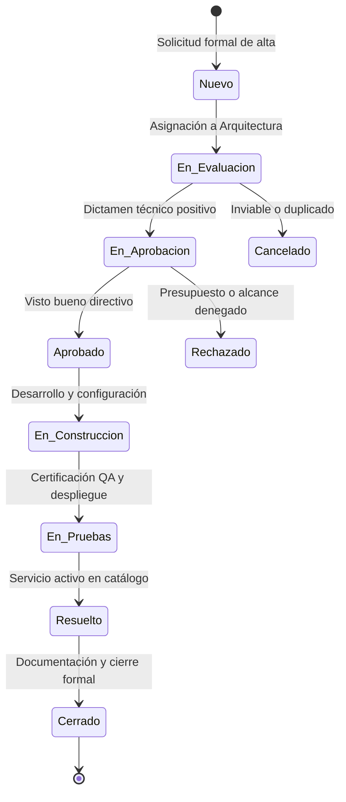
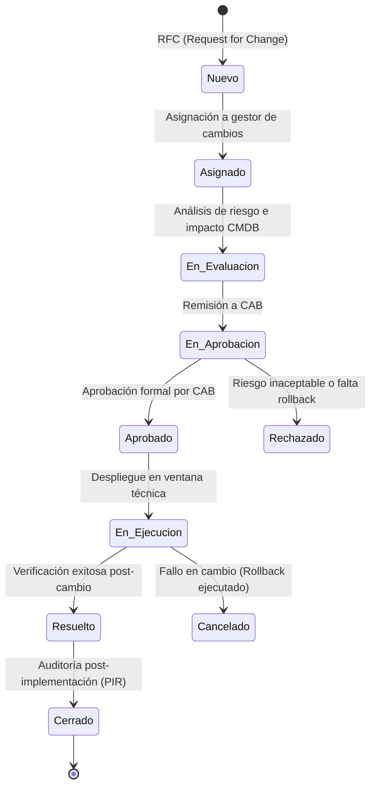
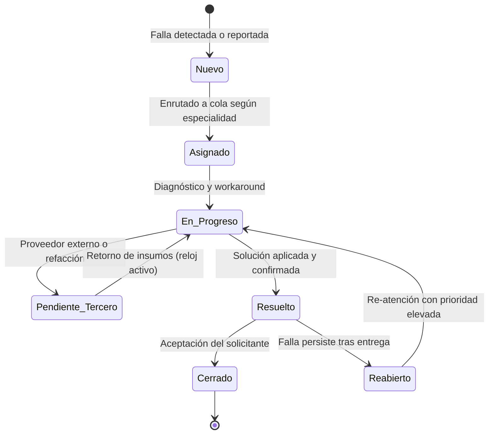
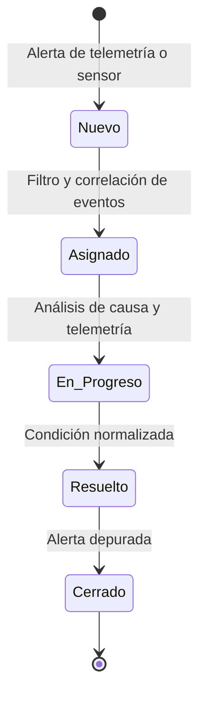
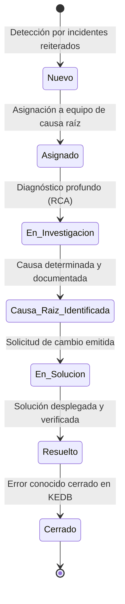
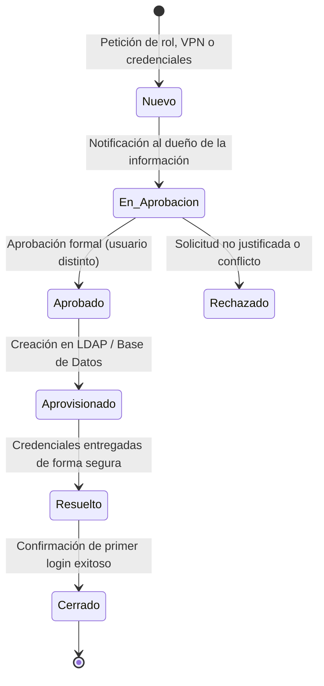
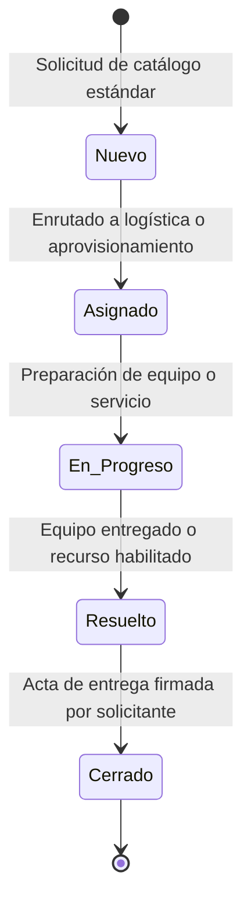

# Especificación de Procesos ITIL y Ciclos de Vida (`docs/PROCESOS.md`)

**Asignatura:** Software Avanzado | USAC  
**Estudiante:** Andrés Calvo | **Carné:** 201712620  
**Catedrático:** Msc. Marco Tulio Aldana Prillwitz | **GitHub:** `maldanap-usac`  
**Proyecto:** Sistema de Service Desk y Gestión de CMDB bajo Estándares ITIL v3 / v4  

---

## 1. Introducción y Arquitectura de Procesos

La operación del Service Desk implementa de manera estricta los **7 procesos de gestión tecnológica** basados en ITIL y las presentaciones del curso (**Lección 25 - Service Desk** y **Lección 22 - CMDB**):

1. **Gestión de Nuevos Servicios:** Transición de servicios desde el diseño e incorporación formal al catálogo corporativo.
2. **Gestión de Cambios:** Control exhaustivo de modificaciones en infraestructura y software para mitigar riesgos e interrupciones no planificadas.
3. **Gestión de Incidentes:** Restauración ágil de la operación normal ante fallas o degradaciones, clasificadas según severidad I0–I6.
4. **Gestión de Eventos:** Monitoreo, clasificación (E0–E3) y correlación de alertas para detonar incidentes preventivos o correctivos.
5. **Gestión de Problemas:** Investigación sistemática de la causa raíz de incidentes recurrentes y registro en la base de errores conocidos (KEDB).
6. **Gestión de Accesos:** Aprovisionamiento y revocación de permisos con estricta segregación de funciones (prohibición de auto-aprobación).
7. **Requisición de Servicios TI:** Despacho estandarizado de peticiones y consumibles preaprobados sin impacto operacional negativo.

---

## 2. Definición Detallada de los 7 Procesos ITIL

### 2.1. Proceso 1: Gestión de Nuevos Servicios

* **Propósito:** Evaluar la viabilidad, alcance técnico y recursos requeridos para incorporar un nuevo servicio al catálogo de TI oficial.
* **Actores:** Solicitante de Negocio, Arquitecto de TI, Comité de Aprobación de Servicios.
* **Reglas de Negocio:**
  - Requiere vinculación con un servicio padre de Nivel 1.
  - Al completar la fase de construcción y despliegue, el servicio debe integrarse en la tabla `servicios_nivel2` y mapearse en la CMDB.

---

### 2.2. Proceso 2: Gestión de Cambios (Change Enablement)

* **Propósito:** Asegurar que los cambios en elementos de configuración (CIs) o servicios se evalúen, autoricen, prioricen y desplieguen minimizando el impacto en el negocio.
* **Actores:** Solicitante del Cambio, Gestor de Cambios, Comité Consultivo de Cambios (**CAB** - *Change Advisory Board*).
* **Reglas de Negocio Estrictas:**
  1. **Aprobación Obligatoria:** Un cambio no puede pasar al estado `En Ejecución` ni `Resuelto` sin haber transitado previamente por `Aprobado`. Cualquier intento de salto directo es rechazado en servidor con `HTTP 400 Bad Request`.
  2. **Plan de Reversión (Rollback):** Todo cambio debe contar con un plan de marcha atrás documentado en caso de fallo durante la ventana de mantenimiento.
  3. **Segregación:** El aprobador debe ser diferente al solicitante.

---

### 2.3. Proceso 3: Gestión de Incidentes

* **Propósito:** Restaurar el servicio acordado en el menor tiempo posible y minimizar el impacto negativo en las operaciones del negocio.
* **Actores:** Solicitante, Operador N1 (Mesa de Ayuda), Especialista N2/N3, Coordinador de Incidentes Mayores.
* **Reglas de Negocio:**
  - **Matriz I0–I6 (Lección 25):** Todo incidente se cataloga de acuerdo con su duración estimada, criticidad del servicio y redundancia de componentes:
    - `I0`: Incidente Mayor / Catástrofe (Interrupción total de servicio crítico sin redundancia, SLA <= 30m).
    - `I1`: Criticidad Alta con afectación masiva (SLA <= 2h).
    - `I2`: Criticidad Alta con afectación parcial o degradación grave (SLA <= 4h).
    - `I3`: Criticidad Media con bypass disponible (SLA <= 8h).
    - `I4`: Criticidad Media sin impacto directo al cliente externo (SLA <= 24h).
    - `I5`: Falla menor o cosmética (SLA <= 48h).
    - `I6`: Consulta o degradación no limitante (SLA <= 72h).
  - **Regla Complementaria:** Si un incidente I2 o I3 no es resuelto dentro de la primera mitad del tiempo comprometido, se escala automáticamente a cola superior (`COLA-N2` o `COLA-INFRA`).
  - **Requisito de Solución:** No se permite pasar a `Resuelto` o `Cerrado` sin el campo `resolucion` completado.

---

### 2.4. Proceso 4: Gestión de Eventos

* **Propósito:** Monitorear todos los eventos de la infraestructura tecnológica a través de alertas, logs y sensores para garantizar la salud operativa.
* **Actores:** Sistema de Monitoreo Automatizado, Centro de Operaciones de Red (NOC), Operador N1.
* **Taxonomía de Eventos (Lección 25):**
  - `E0 - Informativo:` Operación normal programada (ej. backup finalizado con éxito, usuario inició sesión). No requiere acción.
  - `E1 - Advertencia (Warning):` Parámetro fuera de umbral pero sin caída de servicio (ej. disco al 85% de capacidad).
  - `E2 - Excepción Operativa:` Falla de un componente con redundancia activa. Requiere apertura automática de incidente correctivo.
  - `E3 - Crítico / Falla de Servicio:` Caída total de un componente sin redundancia. Genera de inmediato un incidente mayor con severidad I0 o I1.
* **Regla de No Duplicación:** Si ya existe un incidente activo vinculado al CI reportado, el evento E2/E3 se asocia al ticket existente en lugar de crear un ticket duplicado.

---

### 2.5. Proceso 5: Gestión de Problemas

* **Propósito:** Prevenir incidentes recurrentes y minimizar el impacto de aquellos que no se pueden prevenir mediante el análisis de causa raíz (**RCA** - *Root Cause Analysis*).
* **Actores:** Especialista de Problemas, Ingeniero de Infraestructura/Software, Gestor de Cambios.
* **Reglas de Integración:**
  1. Todo problema debe relacionar al menos un incidente origen.
  2. Al identificarse la causa raíz, se registra la solución temporal en la base de errores conocidos (KEDB).
  3. Si la solución definitiva requiere modificar software o hardware, se genera un ticket de **Gestión de Cambios** vinculado.

---

### 2.6. Proceso 6: Gestión de Accesos

* **Propósito:** Otorgar a los usuarios autorizados el derecho a utilizar los servicios tecnológicos, previniendo accesos indebidos o no justificados.
* **Actores:** Solicitante, Jefe Inmediato / Dueño del Dato, Administrador de Seguridad TI.
* **Regla de Oro de Seguridad:**
  - **Prohibición de Auto-Aprobación:** Si el usuario aprobador es el mismo que el usuario solicitante, la transacción es rechazada en servidor con código `HTTP 403 Forbidden`. Se exige segregación estricta de funciones.

---

### 2.7. Proceso 7: Requisición de Servicios TI

* **Propósito:** Atender peticiones estándar de servicios o suministros ya catalogados y pre-aprobados (ej. mouse nuevo, extensión de buzón, equipo portátil estándar).
* **Actores:** Usuario Solicitante, Agente de Atención, Encargado de Almacén/Inventario.
* **Reglas:** Tramitación expedita; flujo directo desde la cola general de mesa de ayuda.

---

## 3. Niveles de Escalamiento Operativo (Lección 25)

El Service Desk organiza el soporte técnico en niveles escalonados para maximizar la resolución al primer contacto (**FCR** - *First Contact Resolution*):

| Nivel | Denominación | Canal / Alcance | Personal Responsable |
|---|---|---|---|
| **Nivel 0** | Autoservicio / FAQ | Portal web interactivo con base de conocimiento, tutoriales y resolución autónoma sin intervención humana. | Solicitante (Autoservicio) |
| **Nivel 1** | Mesa de Ayuda (Help Desk) | Recepción de llamadas, tickets web, triaje, categorización, resolución de solicitudes estándar y fallas menores (I4–I6). | Agentes de Mesa de Ayuda |
| **Nivel 2** | Soporte Técnico Especializado | Diagnóstico técnico avanzado, soporte de campo, servidores, redes y bases de datos locales (I2–I3). | Ingenieros de Soporte N2 |
| **Nivel 3** | Arquitectura y Desarrollo | Modificación de código fuente, bugs críticos en aplicaciones internas, configuración de infraestructura core y RCA de problemas (I0–I1). | Ingenieros de Software y DevOps |
| **Nivel 4** | Proveedores y Fabricantes | Soporte externo bajo contrato de mantenimiento (SLA de terceros), garantías de hardware y licencias propietarias (ej. Cisco, Microsoft). | Fabricantes y Proveedores Externos |

---

## 4. Política de SLAs y Reglas de Pausa

### 4.1. Indicadores de Rendimiento (KPIs)
1. **MTTA (Mean Time to Acknowledge):** Tiempo transcurrido entre la creación del ticket (`fecha_creacion`) y el momento en que un agente lo toma de la cola (`fecha_primera_atencion`):
   $$\text{MTTA} = \text{fecha\_primera\_atencion} - \text{fecha\_creacion}$$
2. **MTTR (Mean Time to Resolve):** Tiempo total neto de resolución, descontando los lapsos en los que el reloj del SLA estuvo pausado:
   $$\text{MTTR} = (\text{fecha\_resolucion} - \text{fecha\_creacion}) - \text{tiempo\_pausado}$$

### 4.2. Política de Pausa en 'Pendiente Tercero'
Cuando un ticket pasa al estado `Pendiente Tercero` (ejemplo: esperando piezas de repuesto en aduana o respuesta de un proveedor externo), el conteo del SLA se suspende formalmente para no penalizar la métrica del equipo interno. Al regresar a `En Progreso`, se acumulan los minutos transcurridos en el campo `tiempo_pausado_minutos` y se recalcula la fecha límite de vencimiento (`fecha_sla_resolucion`).

