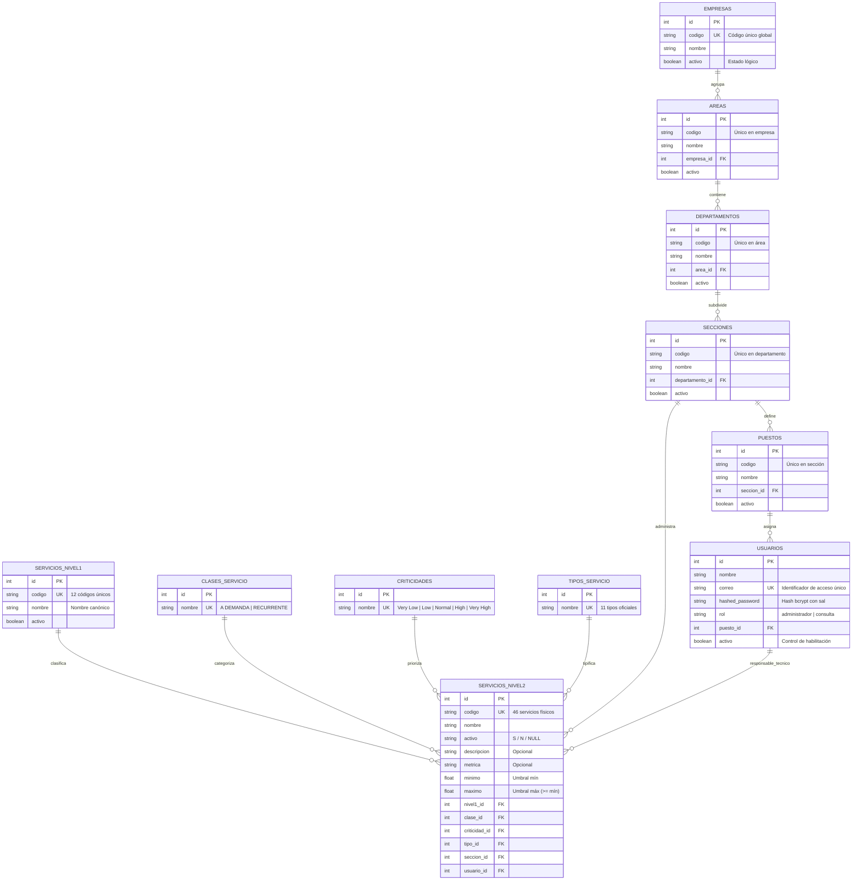

# Informe Técnico de Resolución y Decisiones de Arquitectura (`docs/RESOLUCION.md`)

**Asignatura:** Software Avanzado | USAC  
**Estudiante:** Andrés Calvo | **Carné:** 201712620  
**Catedrático:** Msc. Marco Tulio Aldana Prillwitz | **GitHub:** `maldanap-usac`  
**Proyecto:** Sistema de Gestión del Catálogo de Servicios de TI  
**Repositorio:** `parcial-catalogo-servicios-201712620`  
**Etiqueta de Entrega:** `parcial-v2.0`  

---

## 1. Problema, Alcance y Supuestos

### 1.1. Planteamiento del Problema
En el ámbito de la Gestión de Servicios de Tecnologías de Información (**ITSM** - *IT Service Management*), marcos de trabajo reconocidos como **ITIL** (*Information Technology Infrastructure Library*) y **eSCM** (*enabled Service Capability Model*) enfatizan la necesidad de alinear la provisión tecnológica con las necesidades estratégicas de la organización mediante un catálogo de servicios estructurado, confiable y transparente.

La organización del caso de estudio administraba históricamente sus servicios de TI de forma precaria en una hoja de cálculo (`CatalogoServicios.xlsx`). Esta práctica ocasionaba:
1. **Falta de trazabilidad y gobernanza:** Inexistencia de auditoría sobre modificaciones o bajas de servicios.
2. **Deficiencias de seguridad:** Ausencia de control de accesos basado en roles; cualquier usuario podía alterar fórmulas, umbrales o métricas.
3. **Inconsistencias estructurales en los datos:** Presencia de celdas combinadas verticalmente, registros con nombres divergentes para un mismo código (`SE.12`) y atributos incompletos.
4. **Desvinculación organizacional:** Los servicios de TI no contaban con secciones responsables asignadas ni funcionarios a cargo.

### 1.2. Alcance del Proyecto
* **Sistematización integral del catálogo:** Migración y saneamiento del Excel hacia una base de datos relacional PostgreSQL 15 y consumo vía API RESTful en FastAPI.
* **Mantenimiento en dos niveles:** Nivel 1 (categoría padre) y Nivel 2 (servicio técnico operativo), con catálogos paramétricos normalizados (Clase de Servicio, Criticidad y Tipo de Servicio).
* **Estructura Organizacional jerárquica:** Modelado e implementación de las entidades `Empresa → Área → Departamento → Sección → Puesto → Usuario` con altas, consultas, modificaciones y bajas lógicas.
* **Gobernanza y asignación responsable:** Vinculación obligatoria de servicios Nivel 2 a una Sección responsable y, opcionalmente, a un Usuario responsable perteneciente a dicha sección (Regla P11).
* **Seguridad y Control de Acceso Local (RBAC):** Autenticación local mediante JWT y contraseñas hasheadas con algoritmo especializado con sal (`bcrypt`), diferenciando roles de `administrador` y `consulta`.
* **Aplicación rigurosa de Ingeniería con IA:** Demostración auditable de **Context Engineering**, **Prompt Engineering** y **Harness Engineering** (complementado con **Loop Engineering**).

### 1.3. Supuestos y Decisiones de Negocio
1. **Inmutabilidad de la fuente:** El archivo `data/CatalogoServicios.xlsx` se mantiene intacto y sin ediciones manuales como fuente de verdad original para repetir la ingesta.
2. **Interpretación de filas físicas:** Las filas que carecen de código de Nivel 2 (`COD.N2`) corresponden a continuaciones textuales o notas de pie, por lo que no constituyen servicios independientes.
3. **Resolución canónica de `SE.12`:** Para el código de Nivel 1 `SE.12`, donde coexisten en las filas 99 y 100 las etiquetas *"Suministrar Analitica"* y *"Mantener Tableros de Control"*, se adopta el nombre canónico unificado **"Suministrar Analítica y Tableros de Control"**, preservando la existencia de los 3 servicios dependientes de Nivel 2 (`SE.12.1`, `SE.12.2` y `SE.12.3`) y emitiendo observaciones formales en la bitácora de importación.
4. **Tratamiento de ausencias:** En las filas 99 a 101, los atributos faltantes (clase, criticidad, tipo, métricas y estado) se conservan estrictamente como valores nulos (`NULL`) en base de datos; está prohibido asumir ceros o estados inventados.
5. **Jerarquía sin contradicciones:** La empresa de un usuario se determina unívocamente a través de su puesto y sección, impidiendo relaciones jerárquicas incoherentes.

---

## 2. Arquitectura y Justificación de Tecnologías

El sistema adopta una arquitectura multicapa desacoplada y contenerizada:

```
[ Cliente Web / Navegador ]  <--->  [ NGINX / FastAPI Uvicorn Server ]
                                                |
               +--------------------------------+--------------------------------+
               |                                |                                |
       [ Módulo de Auth ]             [ Endpoints de Negocio ]           [ ETL Ingesta ]
       (bcrypt + JWT local)          (Catálogos & Organización)         (Pandas / ffill)
               |                                |                                |
               +--------------------------------+--------------------------------+
                                                |
                                        [ SQLAlchemy ORM ]
                                                |
                                    [ PostgreSQL 15 Engine ]
                                                |
                                    [ Docker Volume: db_data ]
```

### Justificación de la Pila Tecnológica
* **Docker & Docker Compose (v3.8 / Compose spec):** Garantiza reproducibilidad absoluta en cualquier entorno anfitrión mediante `docker compose up --build -d`, sin exigir la preinstalación de Python ni PostgreSQL en la máquina del evaluador.
* **FastAPI (Python 3.11):** Framework moderno de alto rendimiento basado en Starlette y Pydantic V2. Genera automáticamente la especificación OpenAPI (Swagger UI en `/docs`) y valida tipos y restricciones de negocio en tiempo de ejecución.
* **PostgreSQL 15:** Motor de base de datos relacional robusto que asegura integridad referencial mediante restricciones de clave externa (`FOREIGN KEY`) y unicidad (`UNIQUE`), garantizando transaccionalidad ACID y persistencia mediante volumen Docker (`db_data`).
* **SQLAlchemy 2.0:** Object-Relational Mapper (ORM) que abstrae las consultas SQL, previniendo ataques de inyección SQL mediante sentencias parametrizadas y facilitando la gestión de bajas lógicas y relaciones bidireccionales.
* **Bcrypt nativo (`bcrypt.gensalt()`):** Algoritmo de derivación de claves con función adaptativa y sal aleatoria única por usuario, cumpliendo con la exigencia de no almacenar texto plano ni algoritmos reversibles.
* **Pandas & OpenPyXL:** Motor de análisis y transformación de datos tabulares, ideal para resolver celdas combinadas mediante propagación vectorial (`ffill()`) e ingesta idempotente.
* **Pytest & TestClient:** Entorno automatizado de pruebas de integración para Harness Engineering, validando determinísticamente los escenarios de aceptación P01 a P12.

---

## 3. Diagrama Entidad-Relación y Diccionario de Datos

### 3.1. Diagrama ER (Mermaid)



### 3.2. Diccionario de Datos

| Tabla | Campo | Tipo de Dato | Nulable | Clave | Restricciones / Descripción |
| :--- | :--- | :--- | :---: | :---: | :--- |
| **`empresas`** | `id` | Integer | No | PK | Autoincremental. |
| | `codigo` | String | No | UK | Identificador único empresarial. |
| | `nombre` | String | No | - | Denominación legal de la entidad. |
| | `activo` | Boolean | No | - | `True` por defecto; baja lógica. |
| **`areas`** | `id` | Integer | No | PK | Autoincremental. |
| | `codigo` | String | No | - | Único dentro de la empresa padre. |
| | `nombre` | String | No | - | Nombre de la dirección o área funcional. |
| | `empresa_id` | Integer | No | FK | Referencia a `empresas.id`. No huérfano. |
| | `activo` | Boolean | No | - | Baja lógica. |
| **`departamentos`** | `id` | Integer | No | PK | Autoincremental. |
| | `codigo` | String | No | - | Único dentro del área padre. |
| | `nombre` | String | No | - | Nombre del departamento. |
| | `area_id` | Integer | No | FK | Referencia a `areas.id`. |
| | `activo` | Boolean | No | - | Baja lógica. |
| **`secciones`** | `id` | Integer | No | PK | Autoincremental. |
| | `codigo` | String | No | - | Único dentro del departamento padre. |
| | `nombre` | String | No | - | Nombre de la sección técnica/operativa. |
| | `departamento_id`| Integer | No | FK | Referencia a `departamentos.id`. |
| | `activo` | Boolean | No | - | Baja lógica. |
| **`puestos`** | `id` | Integer | No | PK | Autoincremental. |
| | `codigo` | String | No | - | Único dentro de la sección. |
| | `nombre` | String | No | - | Cargo laboral. |
| | `seccion_id` | Integer | No | FK | Referencia a `secciones.id`. |
| | `activo` | Boolean | No | - | Baja lógica. |
| **`usuarios`** | `id` | Integer | No | PK | Autoincremental. |
| | `nombre` | String | No | - | Nombre completo del colaborador. |
| | `correo` | String | No | UK | Correo corporativo; credencial de acceso. |
| | `hashed_password`| String | No | - | Hash bcrypt de 60 caracteres generado con sal. |
| | `rol` | String | No | - | `administrador` o `consulta`. |
| | `puesto_id` | Integer | Sí | FK | Referencia a `puestos.id`. |
| | `activo` | Boolean | No | - | Si es `False`, el acceso al sistema se bloquea inmediatamente. |
| **`servicios_nivel1`**| `id` | Integer | No | PK | Autoincremental. |
| | `codigo` | String | No | UK | 12 códigos canónicos (ej. `SE.01` a `SE.12`). |
| | `nombre` | String | No | - | Nombre canónico de categoría. |
| | `activo` | Boolean | No | - | Baja lógica. |
| **`servicios_nivel2`**| `id` | Integer | No | PK | Autoincremental. |
| | `codigo` | String | No | UK | 46 códigos físicos de servicio (ej. `SE.01.01`). |
| | `nombre` | String | No | - | Nombre del servicio técnico. |
| | `activo` | String | Sí | - | Indicador original: `'S'`, `'N'` o `NULL` (desconocido). |
| | `descripcion`| String | Sí | - | Detalle funcional opcional. |
| | `metrica` | String | Sí | - | Unidad de medición del SLA. |
| | `minimo` | Float | Sí | - | Umbral inferior de rendimiento. |
| | `maximo` | Float | Sí | - | Umbral superior de rendimiento (`minimo <= maximo`). |
| | `nivel1_id` | Integer | No | FK | Categoría padre obligatoria (`servicios_nivel1.id`). |
| | `clase_id` | Integer | Sí | FK | Referencia a `clases_servicio.id`. |
| | `criticidad_id`| Integer | Sí | FK | Referencia a `criticidades.id`. |
| | `tipo_id` | Integer | Sí | FK | Referencia a `tipos_servicio.id`. |
| | `seccion_id` | Integer | Sí | FK | Sección responsable de la gestión. |
| | `usuario_id` | Integer | Sí | FK | Funcionario responsable (debe pertenecer a `seccion_id`). |

---

## 4. Mapeo Excel → Base de Datos y Calidad de Ingesta

El proceso de ingesta automatizado en `scripts/import_excel.py` aborda de manera determinista cada casuística del archivo original:

### 4.1. Celdas Combinadas
En la hoja `Servicios Externos`, las columnas `A` (`COD.N1`) y `B` (`SERVICIO - Nivel 1`) contienen fusiones verticales de celdas para agrupar múltiples servicios subordinados. Al cargarse con Pandas, las filas intermedias presentan valores vacíos (`NaN`).  
* **Solución:** Se aplicó propagación vectorial controlada mediante `df['COD_N1'].ffill()` y `df['NOMBRE_N1'].ffill()` exclusivamente dentro del rango de datos del catálogo (filas 5 a 101, índice 0 a 96). Esto asocia cada servicio de Nivel 2 a su respectivo padre sin inventar registros ni propagar datos más allá de su bloque.

### 4.2. Conflicto del Código `SE.12`
En las filas 99 y 100 del archivo Excel aparecen dos denominaciones discordantes para la categoría de Nivel 1 `SE.12`:
* Fila 99: `COD.N1 = SE.12`, `NOMBRE_N1 = Suministrar Analitica`
* Fila 100: `COD.N1 = SE.12`, `NOMBRE_N1 = Mantener Tableros de Control`

* **Regla y Justificación:** Con el propósito de no duplicar la categoría y respetar el estándar de unicidad, se estableció como nombre canónico oficial: **"Suministrar Analítica y Tableros de Control"**.  
* **Trazabilidad:** Se registraron en la bitácora ambas apariciones originales con su fila física correspondiente.  
* **Preservación de Servicios Hijos:** Bajo `SE.12` existen tres servicios de Nivel 2 independientes:
  1. `SE.12.1`: *"Suministrar Tableros de Control"*
  2. `SE.12.2`: *"Suministrar Análsis de Información"*
  3. `SE.12.3`: *"Mantener Tableros de Control"*  
  Los tres servicios se importan íntegramente como entidades independientes de Nivel 2 vinculadas a la categoría unificada `SE.12`.

### 4.3. Formato de Códigos de Nivel 2
Los códigos `SE.12.1`, `SE.12.2` y `SE.12.3` poseen formato con un solo dígito final en lugar de dos. Se preservaron estrictamente como cadenas de texto (`VARCHAR`), garantizando que no sufran conversiones numéricas de punto flotante.

### 4.4. Atributos Incompletos (Filas 99 a 101)
Los servicios bajo `SE.12` carecen de datos en Clase, Criticidad, Tipo, Métrica, Umbrales y Estado Activo. Se conservan como valores nulos (`NULL`) en base de datos. Se prohíbe expresamente rellenar con ceros o inferir estados sin sustento formal.

### 4.5. Filtrado de Filas de Continuación y Opciones
El archivo contiene tablas de opciones en las filas `E112:H122`. El importador delimita estrictamente la matriz a las 97 filas de servicios reales y descarta mediante `dropna(subset=['COD_N2'])` cualquier fila auxiliar.

### 4.6. Idempotencia y Reporte Oficial
El importador implementa lógica de `upsert` (insertar si no existe, actualizar si ya existe). Al ejecutar `import_excel.py` en repetidas ocasiones, la cantidad de servicios permanece invariante:
```text
================ RESUMEN DE IMPORTACIÓN Y CALIDAD (3.4) ================
Servicios Nivel 1 Procesados:  12 (N1 en BD: 12)
Servicios Nivel 1 Creados:     12 (0 en re-ejecución)
Servicios Nivel 2 Físicos:     46 (Meta esperada: 46)
Servicios Nivel 2 Creados:     46 (0 en re-ejecución)
Servicios Nivel 2 Omitidos:    51 (filas sin código o notas de pie)
Total Incidencias Observadas:  2
------------------------------------------------------------------------
 * [Filas 99-100] Conflicto Nivel 1 SE.12: Se detectaron nombres divergentes ('Suministrar Analitica' vs 'Mantener Tableros de Control'). Se unifica bajo nombre canónico oficial: 'Suministrar Analítica y Tableros de Control'.
 * [Filas 99-101] Servicios SE.12.1, SE.12.2 y SE.12.3: Poseen atributos incompletos (clase, criticidad, tipo, métrica y activo desconocidos). Se importan preservando valores NULL sin inferir ceros ni estados arbitrarios.
========================================================================
```

---

## 5. Autenticación, Autorización y Seguridad

### 5.1. Algoritmo de Hashing con Sal
* Las contraseñas se procesan mediante `bcrypt` nativo utilizando `bcrypt.gensalt()` con factor de coste estándar (12 rondas de hashing).
* Cada hash generado incorpora una sal criptográfica pseudoaleatoria única, lo que anula la efectividad de ataques basados en tablas arcoíris (*rainbow tables*).
* No se almacena texto plano ni se utilizan funciones reversibles o débiles (MD5, SHA1).

### 5.2. Control de Acceso en Servidor (RBAC)
* La autenticación emite tokens JWT locales firmados con algoritmo HMAC-SHA256 (`HS256`) utilizando la clave secreta `SECRET_KEY` configurada en `.env`.
* **Rol Administrador (`administrador`):** Acceso total a creación, modificación y desactivación lógica de organización, usuarios y servicios (POST, PUT, DELETE).
* **Rol Consulta (`consulta`):** Acceso exclusivo de lectura (GET). Cualquier intento de enviar peticiones mutables es interceptado en el servidor con respuesta inmediata `HTTP 403 Forbidden` (`P03`).
* **Usuarios Desactivados:** El middleware y la función `get_current_user` validan en cada solicitud que `usuario.activo == True`. Un usuario dado de baja no puede autenticarse ni reutilizar un token previo (`HTTP 403`, `P02`).
* **Cierre de Sesión:** El endpoint `/logout` confirma la invalidación y el cliente elimina el token localmente (`P02`).

---

## 6. Evidencias Separadas de las Tres Técnicas de Ingeniería con IA

El desarrollo de este parcial se fundamentó en la integración armónica de las técnicas enseñadas en la cátedra de Software Avanzado 2026:

### 6.1. Context Engineering
* **Fundamento Teórico:** La ingeniería de contexto administra la totalidad del ecosistema de información que rodea al modelo antes de que emita una respuesta (Rajasekaran et al., 2025; Lewis et al., 2020; Yao et al., 2023). Opera a nivel micro en cada turno evitando la pérdida de memoria y la saturación de tokens (presupuesto de 8.000 tokens: 4.500 evidencia, 2.000 instrucciones, 1.000 herramientas, 500 margen).
* **Artefacto Principal:** [AGENTS.md](../AGENTS.md) y directorio versionado [docs/contexto/](../docs/contexto/).
* **Regla Anti-Prompt-Injection:** Toda entrada externa (incluyendo el archivo Excel) fue declarada como datos pasivos no ejecutables.
* **Actualizaciones Versionadas del Contexto:**
  1. *Actualización 1 (Fase 2):* Hallazgo de celdas combinadas y conflicto de `SE.12`. Se inyectó la directiva de propagación `ffill()` y la política canónica para unificar Nivel 1 manteniendo los 3 servicios dependientes intactos ([`docs/contexto/contexto_fase2_revision_excel.md`](contexto/contexto_fase2_revision_excel.md)).
  2. *Actualización 2 (Fase 3):* Conflicto de librerías criptográficas `passlib` con Python 3.11. Se ordenó el uso de `bcrypt` nativo y se incorporó la regla de validación P11 para asignación responsable ([`docs/contexto/contexto_fase3_seguridad_harness.md`](contexto/contexto_fase3_seguridad_harness.md)).

### 6.2. Prompt Engineering
* **Fundamento Teórico:** Diseño y refinamiento de instrucciones mediante la anatomía de 6 piezas (Rol, Objetivo, Contexto, Restricciones, Formato y Criterios) y el patrón `Contexto → Tarea → Restricciones → Salida` (Schulhoff et al., 2024; Sahoo et al., 2024; Wei et al., 2022).
* **Artefacto Principal:** [docs/prompts/prompts_utilizados.md](prompts/prompts_utilizados.md).
* **Cinco Prompts Estructurales Entregados:**
  1. *Prompt 1:* Análisis técnico del Excel y detección de anomalías.
  2. *Prompt 2:* Diseño del modelo relacional y jerarquía organizacional.
  3. *Prompt 3:* Autenticación y autorización local (RBAC).
  4. *Prompt 4:* Ingesta e importación con calidad de datos.
  5. *Prompt 5:* Dockerización, persistencia y Harness Engineering.
* **Dos Iteraciones de Mejora Empírica:**
  1. *Iteración 1:* Corrección de pérdida de servicios en la ingesta de Nivel 2 y resolución del conflicto de clave duplicada en `SE.12`.
  2. *Iteración 2:* Sustitución de `passlib` por `bcrypt` puro y aislamiento idempotente de la suite de pruebas automatizadas.

### 6.3. Harness Engineering
* **Fundamento Teórico:** *"The model is one chip on the board. The harness is everything else that makes it useful"* (Lopopolo, 2026; Fazt, 2026; Young, 2025; Anthropic, 2026). El harness es el entorno de software que encapsula al modelo con herramientas, validadores, aislamiento y mecanismos de prueba observables.
* **Artefacto Principal:** [tests/test_main.py](../tests/test_main.py) y evidencia en [docs/evidencias/reporte_pytest.txt](evidencias/reporte_pytest.txt).
* **Ciclo Completo Demostrado:**
  1. *Tarea:* Implementar la suite de validación de los 12 escenarios de aceptación (P01 a P12).
  2. *Propuesta de IA:* Creación inicial de tests con inserción directa en base de datos.
  3. *Ejecución de Controles:* Al correr `docker exec parcial_backend pytest tests/test_main.py -v`, la suite falló en la segunda ejecución consecutiva con `400 Bad Request` en `test_P04` y `test_P11` debido a colisión de claves únicas (`EMP-P04`, `user_a@demo.com`). Además, `test_P08` falló porque el nombre canónico de Nivel 1 no coincidía.
  4. *Corrección:* Se introdujo aislamiento riguroso en los fixtures y funciones de prueba, purgando registros temporales de prueba antes de cada ejecución y sincronizando la aserción con la denominación canónica de `SE.12`.
  5. *Nueva Ejecución Satisfactoria:* Todos los 12 escenarios finalizaron en verde con código de retorno 0 (`12 passed in 8.23s`).

---

## 7. Matriz de Requisitos vs. Implementación vs. Pruebas vs. Evidencias

| ID | Requisito / Escenario | Implementación Técnica | Prueba Automatizada | Resultado / Evidencia |
| :---: | :--- | :--- | :--- | :--- |
| **P01** | Inicio de sesión válido e inválido | Endpoint `/token`, `verify_password` con bcrypt con sal. | `test_P01_inicio_sesion_valido_e_invalido` | `PASSED` (200 con JWT / 401 Credenciales incorrectas) |
| **P02** | Acceso sin sesión, cierre de sesión y usuario inactivo | Dependencia `get_current_user`, endpoint `/logout`, validación `user.activo`. | `test_P02_acceso_sin_sesion_cierre_sesion_y_usuario_inactivo` | `PASSED` (401 Sin sesión / 200 Logout / 403 Usuario inactivo) |
| **P03** | Usuario de consulta intenta modificar datos | Dependencia `admin_required` verificando el claim `rol`. | `test_P03_usuario_consulta_intenta_modificar_datos` | `PASSED` (200 en GET lectura / 403 Forbidden en POST) |
| **P04** | Crear jerarquía y asignar un usuario | Endpoints CRUD en `main.py` (`/empresas/`, `/areas/`, etc.). | `test_P04_crear_jerarquia_y_asignar_usuario` | `PASSED` (Jerarquía completa persistida y recuperable) |
| **P05** | Código duplicado o referencia inexistente | Validaciones en controlador y restricciones `unique=True`. | `test_P05_codigo_duplicado_o_referencia_inexistente` | `PASSED` (400 Bad Request con mensaje explicativo) |
| **P06** | Importar archivo original (12 N1 y 46 N2) | Script `scripts/import_excel.py` con `ffill` y delimitación. | `test_P06_importar_archivo_original` | `PASSED` (Exactamente 12 códigos N1 y 46 N2 físicos) |
| **P07** | Repetir importación sin duplicar | Lógica de `upsert` e idempotencia en `import_excel.py`. | `test_P07_repetir_importacion_idempotente` | `PASSED` (Conteo inicial == Conteo final; 0 duplicados) |
| **P08** | Revisar SE.12 y atributos ausentes | Política canónica para SE.12 y preservación de nulos. | `test_P08_revisar_SE12_y_atributos_ausentes` | `PASSED` (Nombre canónico oficial y NULLs intactos) |
| **P09** | Mínimo mayor que máximo | Validador `@model_validator` en Pydantic (`schemas.py`). | `test_P09_crear_servicio_minimo_mayor_que_maximo` | `PASSED` (422 Unprocessable Entity impidiendo guardado) |
| **P10** | Buscar y filtrar servicios | Filtros SQLAlchemy `ilike` y parámetros opcionales. | `test_P10_buscar_y_filtrar_servicios` | `PASSED` (Resultados coherentes con filtros de búsqueda) |
| **P11** | Asignar responsable de sección distinta | Validación cruzada `user.puesto.seccion_id == servicio.seccion_id`. | `test_P11_asignar_responsable_seccion_distinta` | `PASSED` (400 Bad Request rechazando asignación inválida) |
| **P12** | Reinicio sin eliminar volúmenes | Persistencia mediante volumen Docker `db_data`. | `test_P12_persistencia_sin_eliminar_volumenes` | `PASSED` (Datos prevalecen tras reconexión a la base) |

---

## 8. Resultados Reales de Pruebas (Harness Engineering)

* **Comando:** `docker exec parcial_backend pytest tests/test_main.py -v`
* **Fecha de Ejecución:** 13 de Octubre 2026
* **Entorno:** Contenedor Docker Debian (`parcial_backend`), Python 3.11.17, PostgreSQL 15
* **Código de Retorno:** `0` (Éxito absoluto)
* **Archivo de Evidencia:** [`docs/evidencias/reporte_pytest.txt`](evidencias/reporte_pytest.txt)

```text
============================= test session starts ==============================
platform linux -- Python 3.11.17, pytest-8.1.1, pluggy-1.6.0 -- /usr/local/bin/python3.11
cachedir: .pytest_cache
rootdir: /app
plugins: anyio-4.15.1
collecting ... collected 12 items

tests/test_main.py::test_P01_inicio_sesion_valido_e_invalido PASSED      [  8%]
tests/test_main.py::test_P02_acceso_sin_sesion_cierre_sesion_y_usuario_inactivo PASSED [ 16%]
tests/test_main.py::test_P03_usuario_consulta_intenta_modificar_datos PASSED [ 25%]
tests/test_main.py::test_P04_crear_jerarquia_y_asignar_usuario PASSED    [ 33%]
tests/test_main.py::test_P05_codigo_duplicado_o_referencia_inexistente PASSED [ 41%]
tests/test_main.py::test_P06_importar_archivo_original PASSED            [ 50%]
tests/test_main.py::test_P07_repetir_importacion_idempotente PASSED      [ 58%]
tests/test_main.py::test_P08_revisar_SE12_y_atributos_ausentes PASSED    [ 66%]
tests/test_main.py::test_P09_crear_servicio_minimo_mayor_que_maximo PASSED [ 75%]
tests/test_main.py::test_P10_buscar_y_filtrar_servicios PASSED           [ 83%]
tests/test_main.py::test_P11_asignar_responsable_seccion_distinta PASSED [ 91%]
tests/test_main.py::test_P12_persistencia_sin_eliminar_volumenes PASSED  [100%]

======================== 12 passed in 8.23s ========================
```

---

## 9. Instrucciones de Docker, Persistencia y Recuperación

### 9.1. Levantamiento desde un Clon Limpio
```bash
# 1. Configurar variables de entorno iniciales
cp .env.example .env

# 2. Compilar imágenes e iniciar contenedores en segundo plano
docker compose up --build -d
```

### 9.2. Hidratación Inicial de la Base de Datos
```bash
# 1. Crear tablas relacionales
docker exec parcial_backend python scripts/init_db.py

# 2. Importar catálogo y procesar calidad de datos (Excel)
docker exec parcial_backend python scripts/import_excel.py

# 3. Crear jerarquía organizacional y usuarios de prueba
docker exec parcial_backend python scripts/create_admin.py
```

### 9.3. URLs de Acceso
* 🌐 **Aplicación Web Interactiva:** [http://localhost:8000/](http://localhost:8000/)
* 📘 **Documentación Swagger UI:** [http://localhost:8000/docs](http://localhost:8000/docs)

### 9.4. Credenciales de Evaluación
* **Administrador:** `admin@demo.com` / `admin123` (Acceso total)
* **Consulta:** `normal@demo.com` / `clave` (Solo lectura)

### 9.5. Detención Normal vs. Reinicio Destructivo
* **Detención normal (Persistencia garantizada de la base de datos):**
  ```bash
  docker compose down
  ```
  *Al volver a iniciar con `docker compose up -d`, los datos persisten íntegramente gracias al volumen `db_data`.*

* **Reinicio destructivo (Limpieza total para re-evaluación):**
  ```bash
  docker compose down -v
  ```
  *Elimina los contenedores y destruye el volumen para iniciar desde cero.*

---

## 10. Limitaciones Conocidas, Aportes y Reflexión sobre la IA

### 10.1. Limitaciones Conocidas
* El sistema no gestiona facturación, cobros ni incidentes en tiempo real, manteniéndose enfocado en el catálogo de servicios e ITSM según el enunciado.
* El logout en el backend confirma la acción y el frontend destruye el token de sesión en `localStorage`; no se implementó una lista negra de tokens revocados en Redis por considerarse fuera del alcance técnico del parcial.

### 10.2. Aporte Individual y Liderazgo Técnico (Andrés Calvo - 201712620)
Como estudiante y líder del desarrollo:
1. **Modelado y Arquitectura:** Diseñé la jerarquía organizacional estricta para garantizar que ningún usuario tenga una relación incoherente con su empresa ni pertenezca a puestos huérfanos.
2. **Auditoría de Ingesta:** Identifiqué que el conflicto de `SE.12` afectaba a la categoría de Nivel 1 y que los 3 servicios dependientes de Nivel 2 debían preservarse íntegramente, evitando la pérdida de registros.
3. **Seguridad y Criptografía:** Tomé la decisión de arquitectura de descartar `passlib` ante la incompatibilidad en Python 3.11, implementando `bcrypt` con sal criptográfica segura.
4. **Harness e Idempotencia:** Diseñé la estrategia de aislamiento en la suite de pruebas para que cada prueba limpie sus datos de prueba y pueda re-ejecutarse infinitamente sin colisiones de claves primarias.

### 10.3. Reflexión Crítica sobre Errores de la IA y Decisiones Humanas
* **El peligro de la alucinación de datos:** En las primeras sugerencias, los modelos de lenguaje tendían a rellenar automáticamente los campos faltantes de las filas 99 a 101 con valores como "Criticidad Media" o umbral `0.0`. Fue fundamental el criterio de ingeniería humana para prohibir la inferencia y exigir valores `NULL`.
* **Falsos atajos de autorización:** Inicialmente, el asistente sugirió simplemente ocultar botones en el frontend para el rol de consulta. Se rechazó este enfoque de inmediato, aplicando el principio de defensa en profundidad: **la autorización debe validarse incondicionalmente en el servidor (`HTTP 403`)**.
* **El valor del Harness Engineering:** Sin un harness estructurado (Docker + PostgreSQL + pytest), las sugerencias de la IA parecían funcionales en código estático pero fallaban en entornos reales por dependencias cruzadas. El harness convirtió el desarrollo asistido por IA en un ciclo medible, reproducible y controlado.
